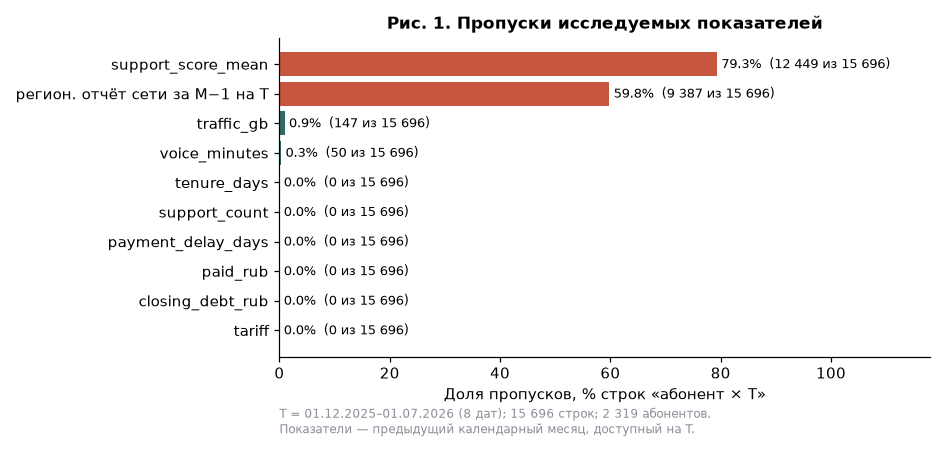
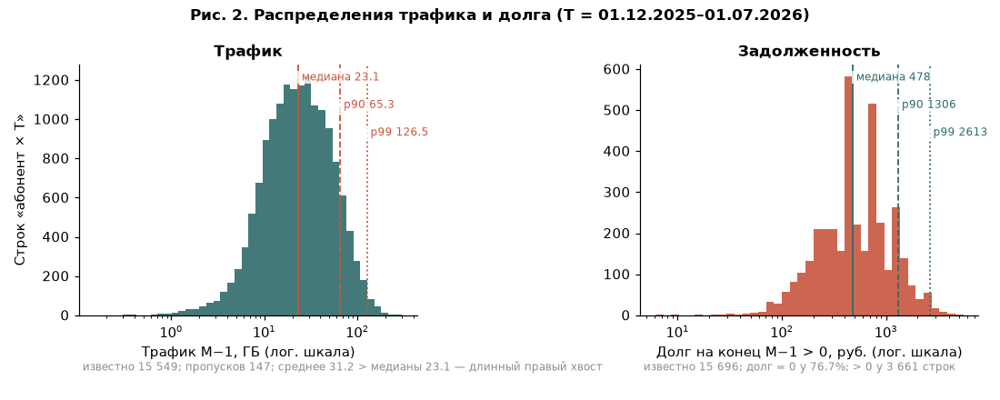
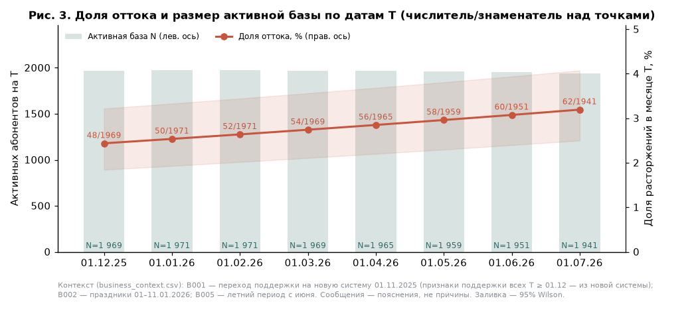
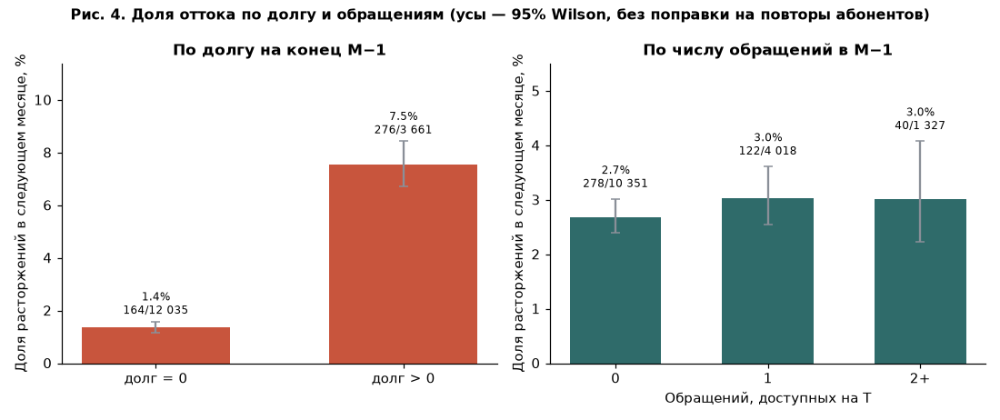
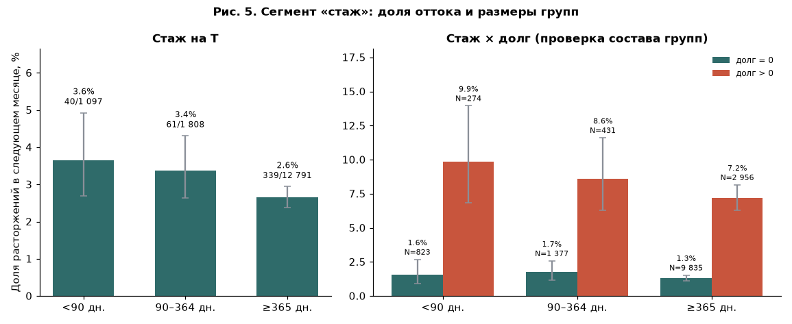
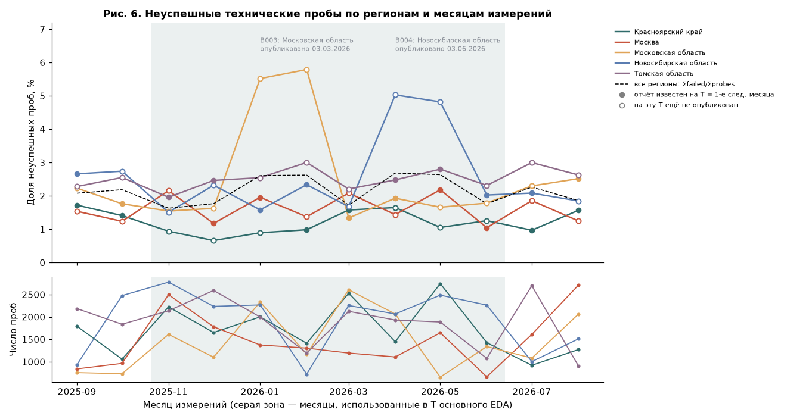

# Отчёт по разведочному анализу (этап 3)

Команда: см. [устав](../stage1_charter/Устав_проекта.md). Версия репозитория: тег `stage-3`. Запуск: `python solution/run_all.py --stage 3` (нужны результаты этапа 2: `--stage 2 --stage 3` или просто `run_all.py`).

## 1. Цель и исследуемая база

Вопросы исследования (из вводной заказчика):

1. Как меняется доля ухода по датам расчёта и меняется ли активная база?
2. Отличается ли доля ухода у абонентов с долгом и без?
3. Связаны ли доступные обращения в поддержку с последующим уходом?
4. Различаются ли группы по стажу, тарифу, региону, и не объясняется ли это составом групп?
5. Что показывают технические измерения сети и можно ли использовать их на дату расчёта?

| Параметр | Принятое правило |
|---|---|
| Единица наблюдения | `(customer_id, snapshot_at)`, абонент × дата расчёта T |
| Даты T для EDA | 01.12.2025 – 01.07.2026, первое число месяца 00:00 МСК, 8 дат |
| Валидация и тест | 01.08.2026 и 01.09.2026 — отложены: метки не строятся, связи не смотрятся |
| Активная база и границы T | `activation_date < T` и (нет `termination` или `termination ≥ T`) — состояние перед событиями дня T |
| Горизонт и исключённый конец | Календарный месяц `[T, первое число следующего месяца)`; `target_end_exclusive` хранится в таблице |
| Источники признаков и их доступность | Строка `customer_month` предыдущего месяца M−1 с `available_at ≤ T` (= ровно T); агрегаты поддержки этой строки — обращения, доступные к T; сеть — отдельная таблица доступности |

**Число строк:** 15 696. **Уникальных абонентов:** 2 319. **Наблюдаемых исходов:** 15 696 — у всех дат EDA горизонт заканчивается не позже 01.08.2026, неизвестных меток нет. **Уходов:** 440, общая доля 2,80%. У всех строк базы есть строка биллинга M−1, никого не исключали.

Таблица: `output/eda_sample.csv`, словарь полей — `output/eda_fields.csv`. Метка формируется отдельной функцией (`snapshots.make_labels`); дата будущего расторжения в таблицу не попадает.

## 2. Распределения и качество

Таблицы: `tables/fig1_missing.csv`, `tables/fig2_distributions.csv`, `tables/describe_numeric.csv`, `tables/describe_categories.csv`.

**Пропуски после подготовки:**

- `traffic_gb` — 147 строк (0,9%): пустой трафик в биллинге означает «неизвестно», а не 0;
- `voice_minutes` — 50 строк (0,3%): исключённые на этапе 2 отрицательные значения;
- `support_score_mean` — 79,3%: не было обращений, закрытие не подтверждено к T или оценку не поставили. Это ожидаемое «нет данных»;
- региональный сетевой отчёт за M−1 неизвестен на T в **59,8%** строк: отчёт публикуется с задержкой 24–48 ч после конца месяца;
- долг, оплата, задержка, тариф, стаж и счётчик обращений известны во всех строках.

**Содержательные нули:**

- `closing_debt_rub = 0` у 76,7% строк — это отсутствие долга;
- `support_count = 0` у 65,9% — нет доступных корректно связанных обращений, но это не доказательство, что абонент не обращался;
- `paid_rub = 0` у 11,7% — абонент не платил в месяце, а не ошибка;
- нулевого трафика в данных нет.

**Экстремальные значения:**

- трафик: медиана 23,1 ГБ, среднее 31,2, p90 65,3, p99 126,5, максимум 289,4 ГБ. Длинный правый хвост правдоподобен (безлимит), значения не удалялись;
- долг > 0 (3 661 строка): медиана 478 руб., p90 1 306, p99 2 613, максимум 5 233. Большой долг копится за несколько месяцев неоплаты и допустим по условиям;
- оплата может превышать начисление при погашении старого долга.

Для каждой статистики число известных значений указано в таблицах (`n_known`, `n_missing`).

## 3. Динамика и различия групп

| T | 01.12 | 01.01 | 01.02 | 01.03 | 01.04 | 01.05 | 01.06 | 01.07 |
|---|---|---|---|---|---|---|---|---|
| Уходов / база | 48/1969 | 50/1971 | 52/1971 | 54/1969 | 56/1965 | 58/1959 | 60/1951 | 62/1941 |
| Доля | 2,44% | 2,54% | 2,64% | 2,74% | 2,85% | 2,96% | 3,08% | 3,19% |

Доля оттока растёт монотонно, а база почти не меняется: 1 941–1 971, потому что подключения (≈50 в месяц) почти компенсируют уходы. Каждая точка опирается примерно на 50–60 событий, поэтому доверительные интервалы соседних дат перекрываются. Важен устойчивый тренд, а не отдельный месяц.

| Группа | Строк | Абонентов | Уходов | Доля | 95% Wilson |
|---|---:|---:|---:|---:|---|
| долг = 0 | 12 035 | 2 241 | 164 | 1,36% | 1,17–1,59% |
| долг > 0 | 3 661 | 1 784 | 276 | **7,54%** | 6,73–8,44% |
| 0 обращений | 10 351 | 2 278 | 278 | 2,69% | 2,39–3,02% |
| 1 обращение | 4 018 | 1 867 | 122 | 3,04% | 2,55–3,61% |
| 2+ обращения | 1 327 | 962 | 40 | 3,01% | 2,22–4,08% |

Группы «неизвестный долг» и «неизвестное число обращений» пусты: показатели известны во всех строках. Доли считаются по строкам «абонент × T». Один абонент встречается на нескольких датах, поэтому интервалы Wilson слишком узкие: они не учитывают повторы.

**Проверка альтернативного объяснения для долга.** Связь сохраняется:

- **внутри каждой из 8 дат T** — отношение долей «долг > 0 / долг = 0» от 3,9 до 7,5 (`tables/debt_ratio_by_month.csv`). Значит, это не эффект одного месяца или сезонности;
- **внутри каждого тарифа** — Basic 1,4% → 6,3%, Comfort 1,4% → 7,8%, Premium 1,2% → 9,2% (`tables/debt_by_tariff.csv`);
- **внутри каждой группы стажа** (рис. 5).

Повторяемость на 8 отдельных датах устойчивее формального теста, который считал бы строки независимыми.

Рядом с долгом — связанные сигналы платёжной дисциплины:

- задержка оплаты > 10 дней: 8,7% против 1,4% при задержке 0 (`tables/churn_by_payment_delay.csv`);
- нулевая оплата в M−1: 10,6% против 1,8% (`tables/churn_by_paid_zero.csv`).

Эти показатели сильно коррелируют с долгом (Spearman 0,79 между долгом и задержкой, `tables/spearman_correlations.csv`), поэтому это один источник риска, а не три независимых.

**Стаж:**

- < 90 дней — 3,65% (40/1 097, 445 абонентов);
- 90–364 дня — 3,37% (61/1 808);
- ≥ 365 дней — 2,65% (339/12 791).

Новички уходят чаще, но интервалы перекрываются, а группа < 90 дней маленькая по числу уходов. Внутри групп долга разница сохраняется: при долге = 0 — 1,6% против 1,3%, при долге > 0 — 9,9% против 7,2%. Значит, различие не объясняется только тем, что у новичков чаще долг. Но оно слабое.

**Тариф и регион:**

- тариф: Basic 2,5%, Comfort 3,0%, Premium 3,1% (`tables/churn_by_tariff.csv`). Внутри тарифа долг остаётся главным различием;
- регион: от 2,4% (Новосибирская обл.) до 3,2% (Красноярский край), интервалы перекрываются (`tables/churn_by_region.csv`).

Все признаки поддержки в периоде EDA взяты из новой системы (B001: переход 01.11.2025), так что смена системы учёта сравнение не искажает (`tables/support_by_system.csv`).

## 4. Сеть и контекст

Таблицы: `tables/fig6_network_rates.csv` (расчёт по регионам и месяцам), `output/network_availability.csv` (ключ `region, measurement_month, snapshot_at`, флаг `known_at_T`), `tables/network_vs_churn_region_T.csv`.

**Правило агрегирования проб:** доля = `failed_probe_count / probe_count`. Для нескольких регионов — `Σfailed / Σprobes` (пунктир на рис. 6), а не среднее долей. Квантили скорости p50/p90 между регионами не усредняются. Число проб (нижняя панель) от 661 до 2 778 в месяц — это не число абонентов.

**Доступность на T:** из 40 пар (регион × T) отчёт за M−1 был опубликован к T только в **16**, в 24 — позже, через 24–48 часов. Для этих строк значение на T неизвестно и остаётся пропуском. Подставлять отчёт следующего месяца нельзя (проверка в `checks_stage3.csv`). На рис. 6 закрашенные точки — отчёты, известные на следующую T, пустые — ещё не опубликованные.

**Что даёт календарь событий:**

- B001 — переход поддержки (01.11.2025, сообщение 20.10.2025);
- B002 — праздники (01–11.01.2026);
- B005 — летний период;
- B003 и B004 — сообщения о повышенной доле неуспешных проб, **опубликованные после описанного периода**. B003 (Московская обл., январь–февраль, 5,5–5,8% против обычных 1,5–2,5%) объявлено 03.03.2026, B004 (Новосибирская обл., апрель–май, ≈5%) — 03.06.2026.

На T = 01.02 и 01.03 сообщения B003 ещё не существовало, поэтому его нельзя превращать в исторический признак этих дат. Календарь не присоединялся к абонентам (many-to-many).

**Ограничения.** Региональная доля технических ошибок не равна доле абонентов с плохой связью. Пробы не являются случайной выборкой опыта абонентов. Ретроспективно доля оттока в Московской области на T = 01.02 была 3,8% (15/395), в Новосибирской на T = 01.05 — 3,8% (15/398). Это выше обычных ~2,5%, но 15 событий на регион — слишком мало для вывода. Кроме того, именно эти отчёты на T ещё не были известны. Связь между известными на T отчётами и долей оттока (16 пар) — Spearman −0,24, то есть не подтверждается. Вывод: на этом объёме технические измерения нельзя считать предиктором индивидуального ухода. Как признак допустим только «последний опубликованный к T отчёт» с указанием возраста, и только как кандидат.

## 5. Результаты гипотез

Журнал — `output/analysis_plan.csv`.

| Гипотеза | Результат и числа | График/таблица | Ограничение | Следующее действие |
|---|---|---|---|---|
| H1 Долг на конец M−1 связан с уходом в месяце T | **Поддерживается.** 7,5% (276/3 661) против 1,4% (164/12 035), в 5,5 раза; на каждой из 8 дат — в 3,9–7,5 раза; сохраняется внутри тарифов и групп стажа | Рис. 4, 5; `debt_ratio_by_month.csv`, `debt_by_tariff.csv` | Повторные наблюдения; долг связан с задержкой и нулевой оплатой; это связь, а не причина | Признаки долга, истории долга, задержки и доли оплаты; baseline — сортировка по долгу |
| H2 Обращения за M−1 связаны с уходом | **Данных недостаточно.** 2,7% / 3,0% / 3,0% для 0 / 1 / 2+, интервалы перекрываются; обращения о связи — 2,8% против 2,8% | Рис. 4; `churn_by_network_ticket.csv` | Только доступные к T корректно связанные обращения; ноль ≠ отсутствие обращений | Окно 3 месяца и темы billing/network — кандидаты, сильного вклада не ждём |
| H3 Доля оттока меняется по T | **Поддерживается.** Монотонный рост 2,44% → 3,19% при стабильной базе 1 941–1 971 | Рис. 3; `fig3_churn_by_T.csv` | 8 точек; возможны состав базы и сезонность | Метрики считать по каждой T отдельно; учитывать дрейф при сравнении train и validation |
| H4 Стаж < 90 дней связан с уходом | **Данных недостаточно** (направление — новички уходят чаще). 3,6% (40/1 097) против 2,6%; интервалы перекрываются; сохраняется внутри групп долга | Рис. 5; `fig5_churn_by_tenure.csv`, `fig5_tenure_x_debt.csv` | Малая группа новичков; повторные наблюдения | Стаж — числовой признак, проверить вклад в модели |

## 6. Переход к признакам

Таблица: `output/feature_directions.csv`.

| Направление | Смысл | Источник | Доступность на T | Риск |
|---|---|---|---|---|
| 1 | Платёжная дисциплина: долг M−1, число месяцев с долгом за 3 мес., изменение долга, задержка, оплата/начисление | billing_clean | Строки ≤ M−1 с `available_at ≤ T` | Биллинг месяца T и месяца расторжения на T недоступен |
| 2 | Изменение использования: трафик M−1, средний за 3 мес., трафик на активный день, изменение M−1 к M−2 | billing_clean | То же; пропуски трафика не заменяются нулём | Неполный месяц подключения занижает суммы — нужна нормировка на `active_days`; разность только при обоих месяцах |
| 3 | Стаж и обращения за 3 месяца по темам с пересчётом на T | subscribers_clean, support_clean | `created_at` в окне и `available_at ≤ T` | Поздно поступившие обращения; флаги карантина — не признаки |

Наблюдаемые связи не называются причинами: для причинного вывода нужно отдельное исследование, например эксперимент с удерживающим предложением.

## 7. Проверки и воспроизводимость

Команда запуска: `python solution/run_all.py`. Версии: Python 3.14.6, pandas 3.1.0, numpy 2.5.1, matplotlib 3.11.2 (`solution/requirements.txt`). Период, горизонт и правило базы — в `solution/config/project.json`.

| Проверка | Результат | Где воспроизвести |
|---|---|---|
| Уникальность ключа и сохранность активной базы | PASS: дубликатов 0; на каждой T число строк = подключения до T − расторжения до T (независимый расчёт по журналу) | `checks_stage3.csv`, строки 1–2 |
| Информация доступна на T | PASS: `billing_available_at ≤ T` во всех строках, месяц показателей = M−1, дата расторжения в таблице отсутствует | строки 3–6 |
| Граничные события и конец горизонта | PASS на искусственном примере: подключение в день T — вне базы; расторжение в T — в базе, метка 1; расторжение в последний день месяца — 1; ровно на конце горизонта — 0; горизонт за 01.10.2026 — метка неизвестна | строки 8–10 |
| Поздний сетевой отчёт | PASS: отчёт ровно на T известен, на 1 с позже — нет; у 24 реальных поздних пар значение пустое | строки 11–12 |
| Групповые суммы и знаменатели | PASS: суммы `n_observations` и `n_churn` по группам T, долга, обращений, стажа = 15 696 и 440 | строки 13–16 |
| Повторный запуск | PASS: повторное построение даёт идентичную таблицу; два полных запуска дают одинаковые sha256 всех файлов | строка 17, `output_manifest.csv` |

**Вклад участников:**

- Участник 3 (исследователь данных) — таблица снимков, рисунки, гипотезы;
- Участник 1 (аналитик) — вопросы, выводы, ограничения, отчёт;
- Участник 2 (инженер по данным) — проверки доступности, сетевая таблица, воспроизводимый запуск.

**Нерешённые ограничения:**

- повторные наблюдения одних абонентов: формальные тесты значимости не проводились, вместо них — повторяемость по датам;
- малое число уходов на дату;
- связь не означает причину.
